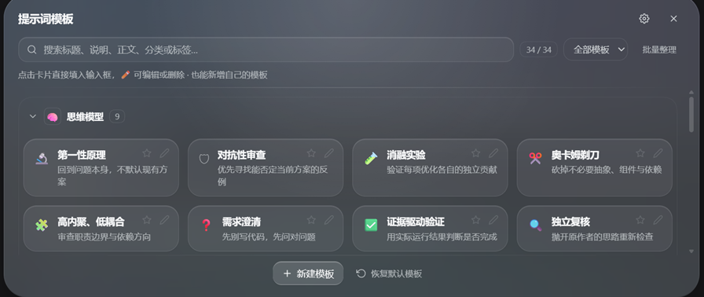

# dsh-prompt-templates

[](https://www.npmjs.com/package/dsh-prompt-templates)
[](./LICENSE)


给 DSH（DeepSeek Harness）用的提示词模板库：分类折叠、搜索筛选、收藏、AI 智能归类，外加一套「思维快捷键」——用一句提示词切换模型分析问题的角度。



> **建议使用深色主题。** 液态玻璃材质在深色背景上层次最明显；浅色主题同样可用，但玻璃与页面的明度差更小，需要靠环境光和边缘高光来分辨。

## 功能

### 模板
- **34 条内置模板**，中英双语
- 新建 / 编辑 / 删除自定义模板：标题、说明、图标、快捷命令、标签、所属分类、完整提示词
- 内置模板可移出模板库，也可「恢复默认」找回
- 收藏（⭐）常用模板
- 点卡片填入输入框时**追加到尾部**，不覆盖已有草稿
- 编辑弹窗内可「填入输入框」或「直接发送」

### 分类
- 初始 8 个分类：思维模型、开发编程、AI 生图、视频创作、学习研究、写作创作、工作效率、其他
- 分类完全由用户数据驱动：新建、重命名、改图标、排序、删除
- 删除分类时强制选择其中模板的去向（移至未分类或指定分类），不会丢模板
- 折叠状态持久化；搜索/筛选时自动展开

### 搜索与筛选
- 搜索标题、说明、正文、分类名、标签，实时过滤
- 筛选：全部 / 收藏 / 未分类 / 指定分类 / 指定标签，可与搜索组合
- 结果中保留分类徽标与标签

### AI 智能归类
- 「批量整理」：对全部模板给出分类 + 标签建议，勾选后「确认应用」才写盘
- 编辑弹窗「✨ 智能识别」：单条识别
- 复用 DSH 自带的 `llm` 服务，不引入额外依赖
- 默认路由自动取当前注册的第一个提供商/模型，**跟随 DSH 设置里的模型配置**
- 手动设置优先：确认界面默认不勾选已有手动分类的模板
- 无法判断时归入「未分类」，不强行归类

## 内置模板

### 思维模型（9 条）

一套通用的 AI Coding 思维快捷键。重点不是让模型按固定步骤机械执行，而是**用一句话切换它分析问题的角度**。

| 模板 | 用在什么时候 |
| --- | --- |
| 第一性原理 | 需求不明确、性能问题、现有方案可能选错方向 |
| 对抗性审查 | 技术方案评审、架构设计、安全审计、Code Review |
| 消融实验 | 性能/模型优化、引入新组件后验证实际收益 |
| 奥卡姆剃刀 | Agent 过度设计、架构臃肿、引入不必要的中间件 |
| 高内聚、低耦合 | 重构、模块拆分、职责混乱、依赖关系复杂 |
| 需求澄清 | 需求模糊、PRD 不完整、多方描述不一致 |
| 证据驱动验证 | 功能开发完成、Bug 修复、准备提交 MR |
| 独立复核 | 重要代码变更、架构方案、准备合并的 MR |
| 资深工程师模式 | 组合版：把上述五个原则一次性带上，用于完整开发任务 |

**建议用法**：不要每次把全部贴进去，按当前任务挑 1–2 个就够。否则这套方法论本身也会变成重型工作流，反而增加 token 消耗和执行负担。

**一个关键区别**：这些提示词帮模型组织分析，但不能保证它真的完成了严谨推理。方法论负责提出正确的问题，测试、日志和实际运行结果负责提供证据，最终判断仍然需要人把关。

### 其他（25 条）

仓库初始化、代码审查、TDD、系统化排错、架构体检、解决合并冲突、需求拷问、转规格、拆工单、交接、持续学习等工程工作流模板。

## 界面行为

- 卡片随窗口宽度自动 4 / 3 / 2 / 1 列，不会出现横向滚动
- 输入框内容再长也不会把面板顶出视口，关闭按钮始终可点

## 安装

```bash
dsh plugin --profile web add dsh-prompt-templates
```

已在 npm 发布：https://www.npmjs.com/package/dsh-prompt-templates

也可以从源码安装（不走 npm）：

```bash
dsh plugin --profile web add github:Apzx7/dsh-prompt-templates
```

装完刷新浏览器即可。宿主半（`index.js`）改动需要重启 DSH，浏览器半（`client.js`）改动热加载。

> 把 `web` 换成你自己的 profile 名即可，例如桌面端默认是 `desktop`。

## 兼容性

| 项 | 说明 |
| --- | --- |
| DSH | 0.2.x（在 0.2.1-rc 上验证） |
| 平台 | Windows 已验证；插件是纯 JS + 浏览器 CSS，其他桌面平台应同样可用 |
| 运行时 | Node.js ≥ 20 |
| 依赖 | 无第三方运行时依赖；AI 归类复用 DSH 自带的 `llm` 服务 |

## 权限与外部服务

- 只在宿主侧注册三个本地 HTTP 端点（`/__prompt-templates/list`、`/mutate`、`/classify`），不发起对外网络请求
- 数据只写在本地 `~/.dsh/prompt-templates.json`
- 「智能识别 / 批量整理」会把模板的标题、说明与正文摘要发送给**你在 DSH 中配置的模型**（默认跟随当前注册的第一个提供商）。若不想让内容离开本机，不使用这两个按钮即可，其余功能完全离线
- 不读取会话内容，不修改其他插件的数据

## 结构

| 文件 | 作用 |
| --- | --- |
| `index.js` | 宿主半：模板 + 分类 + 折叠状态存储；`/__prompt-templates/list`、`/mutate`、`/classify` 三个端点；AI 归类走 `llm.stream` |
| `client.js` | 浏览器半：注册 `conversation.input.left`（图标）与 `conversation.input.overlay`（面板）；Liquid Glass 样式与全部 UI 逻辑 |
| `builtin-templates.json` | 内置模板与初始分类（zh/en 双语） |
| `cordis.patch.yml` | bundle patch，插入 `prompt-templates` 行 |
| `assets/` | README 截图 |

## 数据

`~/.dsh/prompt-templates.json`（可用环境变量 `DSH_PROMPT_TEMPLATES_FILE` 覆盖）：

```json
{
  "version": 3,
  "categories": [ { "id": "mind", "name": "思维模型", "icon": "🧠", "order": 0 } ],
  "items": [
    { "id": "tdd", "hidden": true },
    { "id": "my-tpl", "icon": "📌", "title": "...", "desc": "...", "prompt": "...",
      "category": "mind", "tags": ["review"], "favorite": true }
  ],
  "ui": { "collapsed": { "dev": true } }
}
```

`hidden: true` 表示把该内置模板移出列表；同 id 的完整条目表示覆盖内置默认值。新版本新增的初始分类会自动补给旧数据，不影响用户已有分类。

## 赞赏

如果这个小工具帮你省了点时间，可以请我喝一杯奶茶 ☕ 你的支持是我继续维护它的动力。


> 纯自愿，不赞赏也完全不影响使用；有问题照样提 issue，我都会看。


## 许可

[MIT](./LICENSE)
